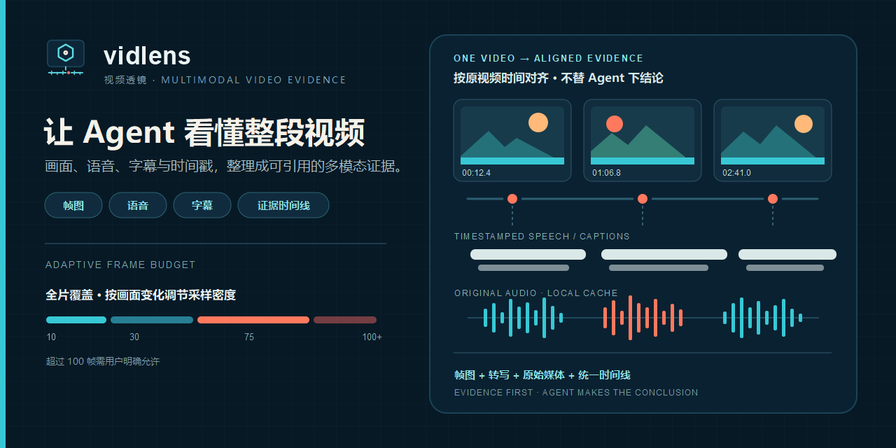

<div align="center">



# vidlens · 视频透镜

**Skill + CLI，让 AI Agent 看懂整段视频：说了什么、画面出现什么，以及分别发生在何时。**

抖音与 B 站 → 原视频、音频、带时间戳转写、自适应帧图和统一证据时间线

[快速开始](#快速开始) · [安装](#安装) · [输出内容](#输出内容) · [平台支持](#平台支持)

[](https://github.com/lordfine/vidlens/actions/workflows/ci.yml)
[](pyproject.toml)
[](LICENSE)
[](#平台支持)

</div>

## 让 Agent 读视频，不只是听视频

vidlens 为调用它的 Agent 准备可引用的多模态证据。工具不生成摘要、不连接多模态 API，也不会把媒体上传到 vidlens 服务；结论由 Agent 使用自己的多模态能力完成。

| 证据 | vidlens 提供什么 |
|---|---|
| 原视频 | 缓存中的本地文件路径，Agent 可查看画面与画面文字 |
| 原音频 | 即使视频已有平台字幕，也始终缓存并在 manifest 中提供路径 |
| 语音与字幕 | 优先保留平台字幕；无字幕时使用本地 ASR，片段带起止时间 |
| 帧图 | 在整段视频范围内自适应取样；按需可对时间区间补帧 |
| 证据时间线 | 按视频时间排序，关联字幕/语音片段与帧图文件 |

## 快速开始

```bash
vidlens prepare "https://v.douyin.com/xxxx/" --granularity medium
```

也支持 B 站：

```bash
vidlens prepare "https://www.bilibili.com/video/BVxxxxxx/" --granularity medium
```

先读输出目录中的 `context.md` 和 `manifest.json`。Agent 可按 `manifest.files.evidence_timeline` 读取统一时间线，并从 `manifest.files.video_local`、`manifest.files.audio_local` 访问缓存媒体。媒体路径在用户清理对应缓存前有效；素材包默认不复制大文件。

### 自适应帧预算

帧预算按画面变化自适应，不按固定帧率把长视频前段抽满：

- 至少 10 帧作为全片覆盖基础，默认以 30 帧为基准，画面稳定时可降至 10 帧；常规上限 75 帧。
- 画面变化明显时可自动扩到 100 帧；超过 100 帧必须先得到用户明确允许，并显式传入 `--allow-over-100-frames`。
- manifest 记录实际帧数、时间戳、图像尺寸和选帧原因。具体图片 token 数由调用模型决定。
- 需要看局部细节时，Agent 可在用户已提供的视频上按时间段补帧：

```bash
vidlens frames "https://v.douyin.com/xxxx/" --mode count --start 120 --end 150 --count 10
```

`--start` 和 `--end` 使用视频秒数，补帧时间戳仍对应原视频时间。

## 安装

vidlens 由两个配合使用的部分组成：CLI 获取并处理视频，Skill 指导 Agent 选择命令、读取多模态证据、核对内容并输出分析。CLI 也可以独立使用。

### 全局安装

使用 [uv](https://docs.astral.sh/uv/) 将 `vidlens` 安装为全局命令：

```bash
uv tool install --python 3.11 git+https://github.com/lordfine/vidlens.git
vidlens doctor
```

升级到 GitHub 上的最新版本：

```bash
uv tool upgrade vidlens
```

### 安装 Skill

CLI 安装包附带与该版本配套的 [SKILL.md](SKILL.md)，安装时不需要额外下载。`--dest` 指定最终技能目录，包含 `vidlens` 目录名。

Codex 示例（PowerShell、bash、zsh 均可使用）：

```bash
vidlens skill install --dest "$HOME/.codex/skills/vidlens"
```

Claude Code 示例：

```bash
vidlens skill install --dest "$HOME/.claude/skills/vidlens"
```

其他支持 `SKILL.md` 的 Agent，将 `--dest` 替换为对应的技能目录。命令返回已安装入口的绝对路径；相同内容重复安装返回 `unchanged`，已有不同内容时会报错。升级 CLI 后重新执行安装命令；确认替换旧入口时加 `--force`，同目录其他文件会保留。

Agent 重新加载技能后，可以直接说“分析这个抖音/B站视频：链接”。Skill 会引导 Agent 调用 CLI，并结合字幕和画面回答。查看当前 CLI 附带的技能源文件：

```bash
vidlens skill info
```

首次本地语音识别需下载约 160 MB；解压后的 SenseVoice 模型缓存占用约 230 MB。之后会复用本机缓存。

### 开发安装

```bash
git clone https://github.com/lordfine/vidlens.git
cd vidlens
uv sync --group dev
uv run vidlens doctor
```

开发时用 `uv run vidlens skill install --dest "目标技能目录/vidlens"` 安装当前源码对应的技能。仓库根目录的 `SKILL.md` 是唯一维护入口，构建 wheel 时自动带入安装包。

## 输出内容

```text
素材包/
├── manifest.json              # 机器可读清单、缓存媒体路径与帧预算
├── evidence-timeline.json     # 按视频时间排序的字幕/语音与帧图索引
├── context.md                 # 给 Agent 的素材导读和时间轴使用说明
├── subtitle.srt / .json       # 平台字幕；无字幕时为 transcript.*
├── frames/                    # 自适应抽样的帧图，带原视频时间戳
└── contact_sheet.jpg          # 便于快速浏览的总览图（部分颗粒度）
```

兼容的旧 manifest 字段继续保留；新时间线、音频路径和预算信息以新增字段提供。

## 命令

| 命令 | 用途 |
|---|---|
| `vidlens meta URL` | 获取元信息与可用字幕轨，不下载视频 |
| `vidlens subs URL` | 获取平台字幕；无字幕时本地 ASR 兜底 |
| `vidlens transcribe URL` | 本地 ASR，生成带时间戳的转写 |
| `vidlens frames URL --mode adaptive` | 全片自适应取帧 |
| `vidlens frames URL --mode count --start 120 --end 150 --count 10` | 对指定时间段补帧 |
| `vidlens prepare URL --granularity coarse\|medium\|fine` | 生成多模态证据素材包 |
| `vidlens cache list\|clean\|stats` | 查看、清理缓存和占用空间 |
| `vidlens doctor` | 检查 ffmpeg、ASR 运行时和网络 |
| `vidlens skill info` | 查看当前版本附带的 Skill |
| `vidlens skill install --dest "目标技能目录/vidlens"` | 安装或更新 Agent 使用的 Skill |
| `vidlens capabilities` | 核对实际调用的 CLI 版本、契约版本和能力 |
| `vidlens export "素材包目录" --out "新目录"` | 导出包含媒体与相对引用的可搬运素材包 |
| `vidlens verify "素材包目录"` | 核验文件引用、时间线与内容指纹 |

常用通用参数：`--cookie`、`--cookie-file`、`--fresh`、`--out`。

### 本地素材与长期保存

视频或音频文件可直接作为输入。源文件保持只读，派生文件进入管理缓存；同名 SRT、VTT 或 JSON 字幕会自动读取，也可显式提供字幕：

```bash
vidlens prepare "本地视频.mp4" --subtitle-file "字幕.srt" --out "素材包目录"
vidlens subs "本地音频.wav" --format txt
vidlens export "素材包目录" --out "可搬运素材包目录"
vidlens verify "可搬运素材包目录"
```

导出目录必须尚不存在。导出会复制原媒体与证据，并改写为相对引用；移动整个目录后可再次运行 `verify`，校验文件引用和 SHA-256 内容指纹。原素材包及源媒体保持不变。纯音频可使用 `meta`、`subs`、`transcribe` 和 `prepare`，其素材包帧集合为空；`frames` 需要视频画面。没有视频流或音轨时，清单中对应媒体引用为 null。

### 版本与缓存一致性

`vidlens capabilities` 返回版本、Agent 契约版本、素材包清单版本和可用能力。当前版本为 0.2.0，Agent 契约版本为 2；Skill 安装后应与实际调用的 CLI 核对能力，开发时优先使用 `uv run vidlens`。

普通命令的参数错误也返回 JSON 和退出码 1；退出码 2 专用于需要登录。显式 `--help` 和 `--version` 使用常规 CLI 文本输出。所有失败均包含恢复提示，产物路径为绝对路径。

媒体、WAV、转写按源内容校验；转写缓存同时核对引擎版本、识别模型、语言和术语修正表（包含执行顺序）。`--fresh` 会重新准备派生音频与识别结果。下载失败保留原有完整缓存，下载产物不会从其他媒体文件中猜选。指定 `--out` 时，已有素材包或同名字幕产物会被保护，应选择新目录；`--fresh` 刷新缓存，不授权覆盖事实层产物。

## 平台支持

| 运行平台 | 支持范围 | 备注 |
|---|---|---|
| Windows x86_64 | 完整工作流 | SenseVoice 使用 `sherpa-onnx` wheel 自带运行时 |
| Linux x86_64 | 完整工作流 | 缓存遵循 `XDG_DATA_HOME` |
| macOS Intel | 完整工作流，最低 macOS 10.15 | 依赖 wheel 支持范围 |
| macOS Apple Silicon | 完整工作流，最低 macOS 11.0 | 依赖 wheel 支持范围 |

抖音与 B 站都支持以上运行平台。B 站登录态可通过 `--cookie` 或 `--cookie-file` 提供，以访问高清媒体与字幕；vidlens 不会读取浏览器登录状态。

CI 在 Windows/Linux 上运行 Python 3.11 与 3.14 检查；macOS Intel 与 Apple Silicon 检查目前为非阻断项，用于持续发现兼容问题。

## Agent 契约与故障排查

- stdout 输出 JSON，错误写入 stderr；错误对象包含可执行的 `hint`。
- 媒体缓存共享，ASR 转写缓存共享；每次调用的产物目录彼此独立。
- 模型首次下载会串行化，避免并发任务写坏模型文件。
- Windows 首次本地转写若出现 `python.exe - 应用程序错误`，请从[微软官方页面](https://learn.microsoft.com/en-us/cpp/windows/latest-supported-vc-redist?view=msvc-170)安装或修复最新版 Visual C++ v14 x64 运行库，再重试原命令；不要删除或覆盖 `System32` 中的 DLL。
- 抖音风控时可提供 `--cookie`；不要把 cookie 提交到 issue 或公开日志。

## 开发与校验

```bash
uv run ruff check src tests
uv run pytest -q
uv build --out-dir dist
uv run python -X utf8 scripts/验证分发.py
```

分发验证会创建临时独立环境，从 wheel 安装全部依赖，验证 Skill 安装和本地视频的素材包导出、搬迁与校验。CI 在 Windows 与 Linux 执行相同检查。

真实平台链路需要显式启用 `VIDLENS_E2E=1`。本地 ASR 模型只在首次转写时下载。

## 致谢

[yt-dlp](https://github.com/yt-dlp/yt-dlp) · [sherpa-onnx](https://github.com/k2-fsa/sherpa-onnx) · [SenseVoice](https://github.com/FunAudioLLM/SenseVoice) · [faster-whisper](https://github.com/SYSTRAN/faster-whisper) · [imageio-ffmpeg](https://github.com/imageio/imageio-ffmpeg)

## 许可

[MIT](LICENSE)
